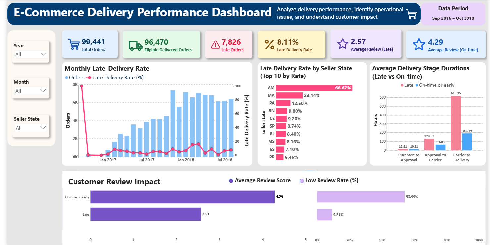
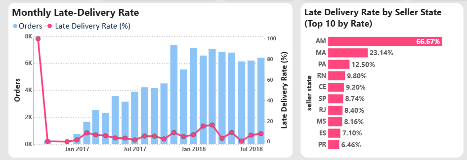
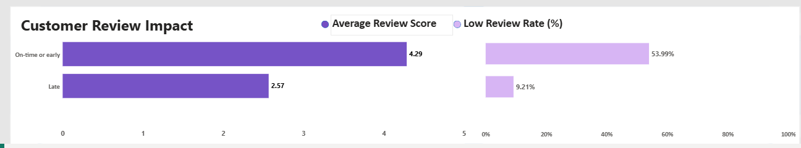

# Olist E-commerce Delivery Performance Analytics Dashboard

## 📌 Project Overview

This project analyzes the Olist Brazilian E-commerce dataset to understand delivery performance, identify late deliveries, and evaluate the relationship between delivery outcomes and customer satisfaction.

Using **PostgreSQL, SQL, Python, Power BI, and DAX**, this project transforms e-commerce data into an interactive dashboard that helps explore delivery trends, seller-state performance, delivery-stage durations, and customer reviews.

## 📸 Dashboard Preview

<!-- Replace these filenames with the actual images in your screenshots folder. -->

### Executive Summary


### Delivery Performance Analysis


### Customer Review Analysis


## 🎯 Business Objectives

- Measure overall delivery performance and late delivery rates.
- Compare late deliveries with on-time or early deliveries.
- Analyze delivery performance across seller states.
- Identify monthly trends in delivery delays.
- Investigate the duration of different delivery stages.
- Understand how delivery outcomes relate to customer review scores.
- Present actionable insights through interactive Power BI visualizations.

## 🛠️ Tools & Technologies

- **PostgreSQL** — Data storage, SQL analysis, validation, and analytical views.
- **SQL** — Joins, aggregations, data checks, delivery-stage analysis, and KPI calculations.
- **Python** — Data checking, cleaning, validation, and loading scripts.
- **Power BI** — Interactive dashboards, KPI cards, charts, and slicers.
- **DAX** — Measures for delivery performance and customer review analysis.
- **Git & GitHub** — Version control and project documentation.

## 📊 Key Performance Indicators

| Metric | Result |
|---|---:|
| Total Orders | 99,441 |
| Eligible Delivered Orders | 96,470 |
| Late Orders | 7,826 |
| Late Delivery Rate | 8.11% |
| Average Review Score — Late Deliveries | 2.57 |
| Average Review Score — On-time or Early Deliveries | 4.29 |

*Note: Delivery rates are calculated using eligible delivered orders. Review scores are based on eligible delivery reviews. Dashboard results may change when filters are applied.*

## 🔍 Key Findings

### 1. Delivery Performance

- The dataset contains 99,441 orders.
- Of these, 96,470 were eligible for delivery performance analysis.
- A total of 7,826 eligible orders were classified as late.
- The overall late delivery rate was approximately **8.11%**.

### 2. Customer Satisfaction

- Late deliveries had an average review score of **2.57 out of 5**.
- On-time or early deliveries had an average review score of **4.29 out of 5**.
- This difference indicates an association between delivery outcomes and customer satisfaction in the analyzed data.

### 3. Seller-State Performance

The previously calculated state-level results identified the following areas for further investigation:

| Seller State | Late Delivery Rate | Eligible Orders |
|---|---:|---:|
| Maranhão (MA) | 23.14% | 389 |
| Pará (PA) | 12.50% | 8 |
| Rio Grande do Norte (RN) | 9.80% | 51 |

These figures are based on the seller-state analysis. An order associated with multiple seller states may be counted in more than one state, so state-level counts should not be added together to calculate overall totals.

**Important:** Rates based on small numbers of orders can fluctuate considerably. The state results should be investigated alongside order volumes before drawing operational conclusions.

### 4. Monthly Delivery Trends

Monthly delivery performance is analyzed using SQL views and Power BI visualizations. The dashboard allows users to explore late delivery rates across months and filter the results by seller state.

A month with very few eligible orders can show an unusually high late delivery rate. For example, September 2016 showed a 100% rate based on one eligible order. This result should not be interpreted as evidence of a sustained monthly delivery problem.

## 📈 Dashboard Features

- KPI cards showing total orders, eligible delivered orders, and late orders.
- Monthly late delivery rate analysis.
- Seller-state delivery performance comparison.
- Customer review score comparison by delivery result.
- Low customer review rate analysis.
- Delivery-stage duration and lateness analysis.
- Interactive slicers and cross-filtering for exploring the data.

## 🗄️ Project Workflow

1. **Data inspection:** Examined the source data and checked data quality.
2. **Data cleaning:** Used Python scripts to support data preparation.
3. **Database loading:** Loaded order, review, and supporting data into PostgreSQL.
4. **SQL analysis:** Analyzed delivery performance, monthly trends, seller states, customer reviews, and delivery stages.
5. **View creation:** Created SQL views to prepare analytical datasets for Power BI.
6. **Data validation:** Checked row counts, duplicate order IDs, eligible orders, and delivery classifications.
7. **Dashboard development:** Connected PostgreSQL views to Power BI and developed KPI cards, charts, slicers, and DAX measures.
8. **Results verification:** Compared key dashboard metrics against SQL query results.

## 📂 Repository Structure

```text
olist-ecommerce-delivery-analytics/
│
├── README.md
├── .gitignore
├── .env.example
│
├── icons/
│
├── sql/
│   ├── 01_connection_check.sql
│   ├── 02_basic_data_checks.sql
│   ├── 03_monthly_delivery_analysis.sql
│   ├── 04_worst_delivery_months.sql
│   ├── 05_delivery_stage_analysis.sql
│   ├── 06_stage_duration_by_lateness.sql
│   ├── 07_late_delivery_by_seller_state.sql
│   ├── 08_review_score_by_delivery_result.sql
│   ├── 09_executive_summary.sql
│   ├── 10_create_monthly_delivery_view.sql
│   ├── 11_create_review_impact_view.sql
│   ├── 12_create_seller_state_view.sql
│   ├── 13_create_stage_comparison_view.sql
│   ├── 14_create_kpi_summary_view.sql
│   ├── 15_create_monthly_review_impact_view.sql
│   ├── vw_state_delivery_stage_details.sql
│   ├── vw_state_monthly_delivery_performance.sql
│   └── vw_state_review_details.sql
│
├── src/
│   ├── check_data.py
│   ├── check_dates.py
│   ├── clean_data.py
│   ├── investigate_durations.py
│   ├── load_orders_to_postgres.py
│   ├── load_reviews.py
│   ├── load_supporting_tables.py
│   └── validate_data.py
│
├── powerbi/
│   └── delivery_performance_dashboard.pbix
│
└── screenshots/
    ├── executive-summary.png
    ├── delivery-performance.png
    └── customer-reviews.png
```

*This is a suggested structure based on the files currently identified. Update filenames and folders to match your actual repository. Include the Power BI file and screenshots only if you have added them.*

## 🚀 How to Explore the Project

### Prerequisites

- PostgreSQL
- Python 3
- Power BI Desktop
- The Olist Brazilian E-commerce dataset

### Steps

1. Clone or download this repository.
2. Download the dataset from [Kaggle — Brazilian E-Commerce Public Dataset by Olist](https://www.kaggle.com/datasets/olistbr/brazilian-ecommerce).
3. Configure your PostgreSQL database and connection settings.
4. Install any Python dependencies required by your scripts.
5. Run the Python scripts as needed for data preparation, loading, and validation.
6. Execute the SQL scripts to inspect the data, perform analysis, and create the required views.
7. Open the Power BI dashboard file, configure the database connection, and refresh the data.
8. Use the dashboard slicers to explore delivery performance by month and seller state.

*The exact execution order may depend on the dependencies between your SQL views and Python scripts.*

## 💡 Business Recommendations

- Investigate seller states with consistently high late delivery rates, taking order volume into account.
- Monitor monthly delivery performance to identify potential changes in delivery reliability.
- Analyze delivery-stage durations to identify stages that may contribute to delays.
- Compare customer reviews across delivery outcomes to understand where customer experience may be affected.
- Use validated delivery metrics to prioritize further investigation and operational improvements.

These recommendations identify areas for further analysis; the available results do not independently establish the causes of delivery delays.

## 📚 Skills Demonstrated

SQL • PostgreSQL • Python • Power BI • DAX • Data Cleaning • Data Validation • Exploratory Data Analysis • KPI Development • Data Visualization • Business Intelligence • Analytical Problem-Solving

## 👩‍💻 Author

**Vaitla Surekha**

Aspiring Data Analyst

- [LinkedIn Profile](https://www.linkedin.com/in/surekhavaitla/)

---

*This project demonstrates an end-to-end data analytics workflow, from data preparation and SQL analysis to interactive dashboard development and business insights.*
